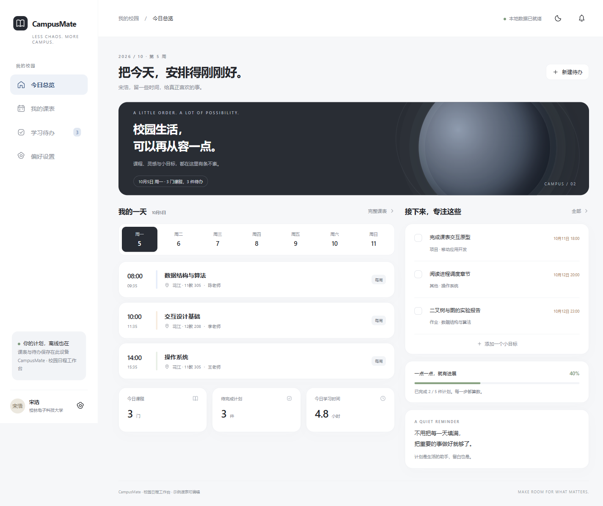

# CampusMate · 校园课表与待办助手

CampusMate：HarmonyOS 校园课表与待办助手，包含 ArkTS 原生工程、Web 交互、离线快照、备份恢复与提醒配置。

作者：宋浩 · 桂林电子科技大学 · 计算机科学与技术 · 2027 届。

[个人作品集](https://shjhijoaj.github.io/hao-song-portfolio/) · [项目详情](https://shjhijoaj.github.io/hao-song-portfolio/projects/campus.html) · [下载运行包](https://github.com/shjhijoaj/campusmate/releases/tag/v2.1.0)

## 功能

- **课表与任务**：课程时间与周次管理、单双周显示、CSV 导入，待办新增、编辑、完成与删除，支持无截止时间任务。
- **离线数据管理**：完整备份校验、双槽快照与数据恢复；通过版本检查协调多窗口编辑，让保存与读取保持一致。
- **提醒与主题**：支持提前与重复提醒配置、深浅主题，并将原生提醒通道与应用日程数据衔接。

## 本人职责

负责课程与待办功能、页面交互、CSV 导入、离线快照、主题与提醒配置，并完成数据规则、存储流程及构建验证。

## 快速开始

### 便携包

Windows x64：解压后运行 启动演示.cmd，浏览器访问 http://127.0.0.1:4179/。运行包随附 Node.js，无需另外安装依赖。

### 从源码运行

浏览器版需 Node.js 22.16+：`node browser-demo/server.mjs`，访问 http://127.0.0.1:4179/。鸿蒙原生工程使用 DevEco Studio 5.1 和 API18 SDK 打开；安装到设备前，在 DevEco 配置自己的开发签名。

## 实现

校验完整快照后再恢复数据；原生存储采用 A/B 双槽提交和损坏回退。页面保存失败时保留编辑内容，检测跨窗口修改并拒绝旧数据覆盖。

数据链路：ArkUI / 浏览器界面 → 课程与任务规则 → 快照校验 → 离线持久化 → 提醒适配。

## 验证

49 项数据规则与服务回归通过，完成浏览器课程、任务、导入、备份、主题与多窗口流程验证，以及 ArkTS 构建。

## 组件与许可

项目自有源码保留作者著作权，第三方库遵循各自许可证。依赖及参考说明见 [THIRD_PARTY_NOTICES.md](THIRD_PARTY_NOTICES.md)。
